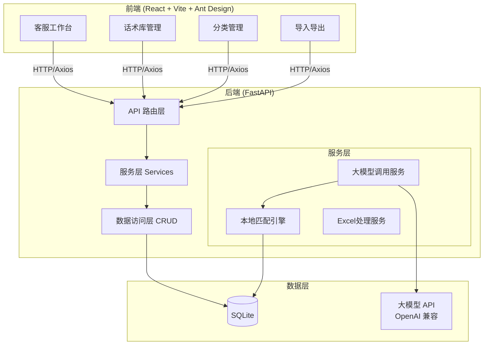
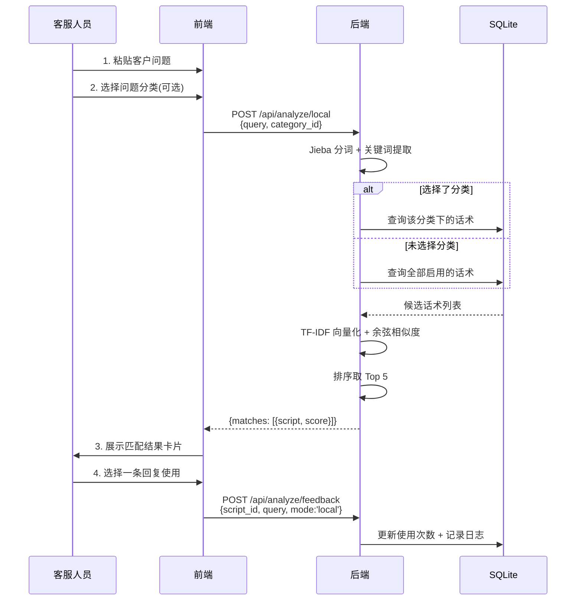
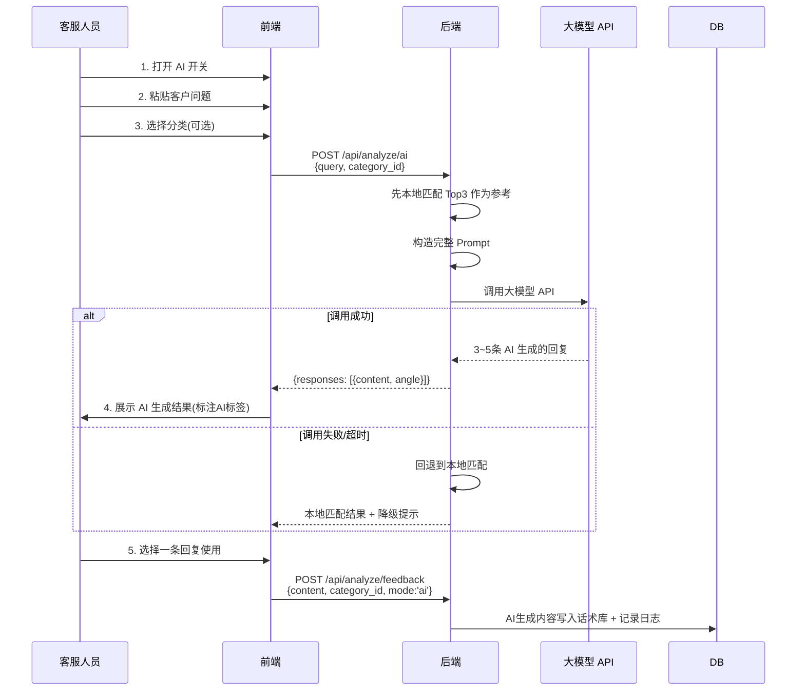
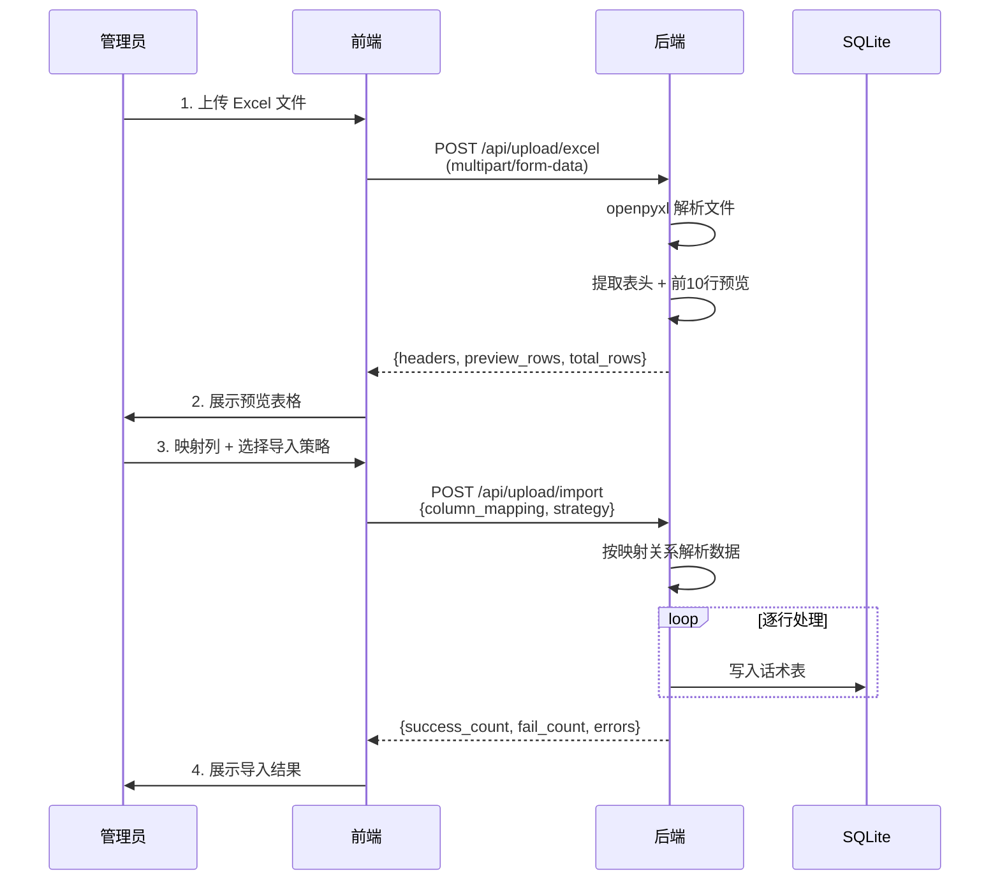
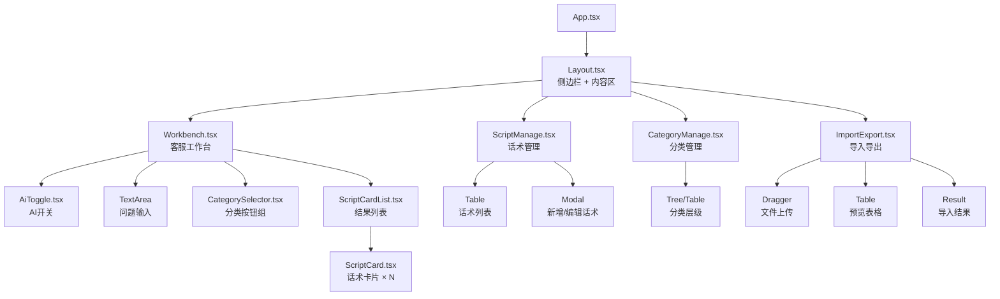
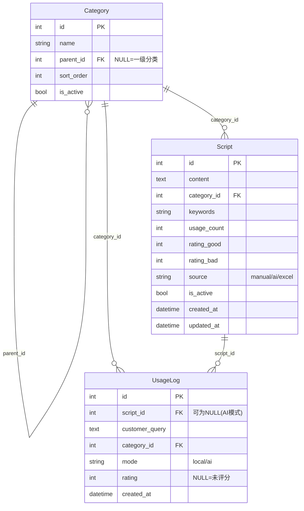
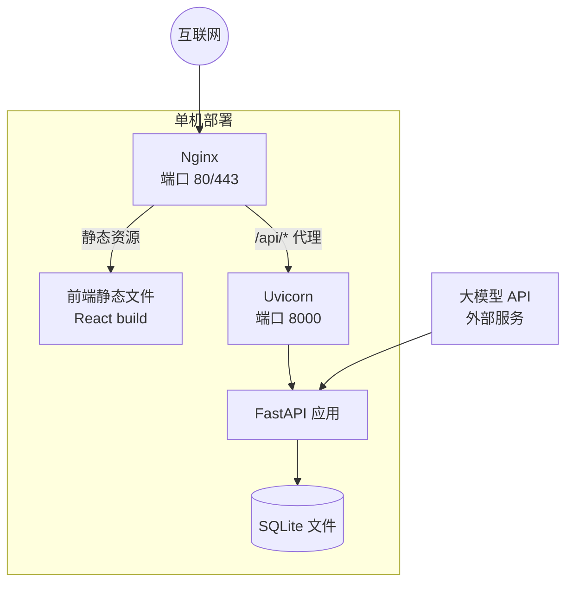

# 智能客服话术库系统 — 系统架构设计

> 版本: v1.0  
> 更新日期: 2026-07-15

---

## 一、整体架构图

---

## 二、核心流程设计

### 2.1 本地匹配模式流程

### 2.2 AI 智能模式流程

### 2.3 Excel 导入流程

---

## 三、前端组件树

---

## 四、数据库 ER 图

---

## 五、API 接口设计

### 5.1 分类接口

| 方法 | 路径 | 说明 |
|------|------|------|
| GET | `/api/categories` | 获取分类树（含话术计数） |
| GET | `/api/categories/{id}` | 获取单个分类详情 |
| POST | `/api/categories` | 新增分类 |
| PUT | `/api/categories/{id}` | 编辑分类 |
| DELETE | `/api/categories/{id}` | 删除分类（检查关联） |

### 5.2 话术接口

| 方法 | 路径 | 说明 |
|------|------|------|
| GET | `/api/scripts` | 话术列表（分页+搜索+筛选） |
| GET | `/api/scripts/{id}` | 话术详情 |
| POST | `/api/scripts` | 新增话术 |
| PUT | `/api/scripts/{id}` | 编辑话术 |
| DELETE | `/api/scripts/{id}` | 删除话术 |
| POST | `/api/scripts/batch-delete` | 批量删除 |
| PUT | `/api/scripts/{id}/toggle` | 启用/禁用切换 |

### 5.3 智能分析接口

| 方法 | 路径 | 说明 |
|------|------|------|
| POST | `/api/analyze/local` | 本地匹配分析 |
| POST | `/api/analyze/ai` | AI 智能分析 |
| POST | `/api/analyze/feedback` | 用户反馈（使用/评分） |

### 5.4 导入导出接口

| 方法 | 路径 | 说明 |
|------|------|------|
| POST | `/api/upload/excel` | 上传 Excel 并预览 |
| POST | `/api/upload/import` | 确认导入 |
| GET | `/api/export/scripts` | 导出话术为 Excel |
| GET | `/api/export/template` | 下载导入模板 |

---

## 六、关键设计决策

### 6.1 为什么选择 SQLite？

- 客服话术数据量级小（通常在万条以内）
- 不需要额外的数据库服务器，降低部署复杂度
- 数据文件可直接备份、迁移
- SQLAlchemy 支持良好，未来可无缝切换到 PostgreSQL/MySQL

### 6.2 本地匹配算法选择

- **jieba 分词**：中文分词成熟方案，轻量无依赖
- **TF-IDF + 余弦相似度**：经典文本相似度方案，对于短文本（客服话术通常较短）效果好
- **预加载索引**：启动时将话术库加载到内存，避免每次请求都查询数据库
- **分类预过滤**：如果用户选了分类，大幅缩小候选集，提升匹配精度和速度

### 6.3 AI 模式设计考量

- **本地匹配作为参考**：将本地匹配 Top3 作为 Prompt 中的参考话术，帮助大模型理解语境
- **结构化输出**：要求 JSON 格式输出，便于前端解析展示
- **降级策略**：AI 不可用时自动回退本地模式，保证系统可用性
- **反馈闭环**：AI 生成的优质回复可以沉淀到话术库，逐步减少对 AI 的依赖

### 6.4 前端状态管理策略

- 项目规模适中，不引入 Redux/Zustand 等状态管理库
- 使用 React 内置的 `useState` + `useEffect` 管理组件状态
- API 调用结果直接驱动 UI 更新
- 跨组件共享的状态（如分类列表）通过 props 或 Context 传递

---

## 七、部署架构

### 部署要点

1. 前端 `npm run build` 生成静态文件，由 Nginx 托管
2. Nginx 配置反向代理 `/api/*` → `http://127.0.0.1:8000`
3. 后端使用 `uvicorn` 或 `gunicorn + uvicorn worker` 运行
4. API Key 等敏感信息通过 `.env` 文件或环境变量注入
5. SQLite 文件放在项目目录外或做好权限控制
